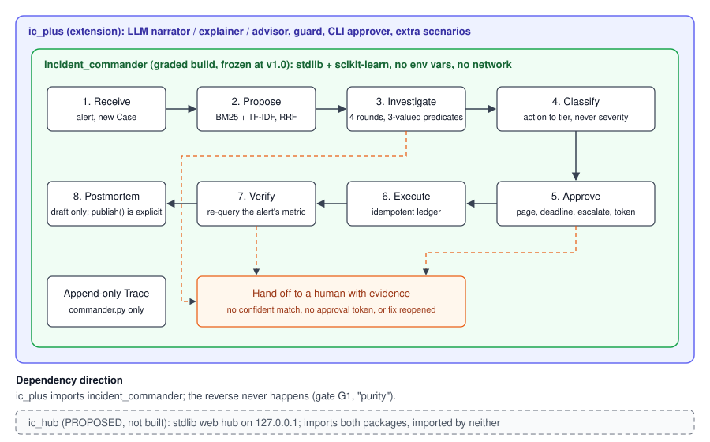

# Architecture

Incident Commander is one deterministic agent (the graded build, `incident_commander/`, frozen at tag `v1.0`)
plus an optional extension package (`ic_plus/`). The dependency points one way: `ic_plus` imports
`incident_commander`, never the reverse (gate G1). Decisions use typed evidence only; severity, log text and
LLM output never feed one. The authoritative module list and folder tree are in
[`memory-bank/architecture.md`](../memory-bank/architecture.md); this page is the overview.

## One alert, step by step

1. **Receive:** the Commander opens a Case and writes the first trace event.
2. **Propose:** `retrieval.py` ranks runbooks with BM25 and character TF-IDF fused by RRF (k=60). Retrieval only
   proposes candidates; it never decides.
3. **Investigate:** up to four rounds. Each round makes one read-only tool call, checks freshness, re-evaluates
   three-valued predicates and updates hypotheses. The toolbox has no log tool (see
   [ADR-0003](adr/0003-investigator-has-no-log-tool.md)). The verdict is `matched` or `no_confident_match`.
4. **Classify:** `blast_radius.py` maps the runbook's action to a tier and an approval requirement. An unknown
   action is high tier.
5. **Approve:** high tier pages the primary on a real monotonic deadline, escalates to the secondary, and issues
   an `ApprovalToken`. No token means stop and hand off.
6. **Execute:** once, under an idempotency key. A retry returns `already_executed` with the same id.
7. **Verify:** re-query the alert's own metric; resolved if it is within baseline x 1.10 on fresh data, else
   reopened.
8. **Postmortem:** a pure draft (`notified=[]`, `published=False`); only an explicit `publish()` has a side effect.

Handoff to a human happens on no confident match, a missing approval token, or a reopened fix. There is never an
automatic second fix.

## Extension (`ic_plus`)

Runs the same pipeline with `--llm off|local|hosted`. LLM roles (narrator, explainer, advisor) see structured
trace facts only, every reply passes a deterministic guard, and any failure falls back to a template. DECISION
lines are identical with the LLM on or off (checked by `ic_plus evaluate` and `tests_plus/test_release.py`).
See [ADR-0002](adr/0002-deterministic-agent-over-llm.md).

## Proposed: `ic_hub`

A stdlib-only local web hub, not built and pending owner approval. See [ADR-0004](adr/0004-hub-stdlib-only.md)
and [EXTENSION_PLAN.md](EXTENSION_PLAN.md).
