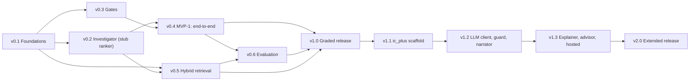

# Detailed Roadmap — PS4 "The Incident Commander"
---

## 0. How to use this roadmap

- Build **in order**, one version at a time. A version is finished only when its **tests pass**, all **earlier gates still pass**, its **trace is saved** to `traces/vX.Y.txt`, and the git tag exists.
- "Size" is relative effort (S < M < L), not time. Your deadline is unknown, so §9 gives cut lines.
- Versions `v0.x` build the graded (statement) version. `v1.0` is the **graded release**. `v1.1`–`v2.0` build the **extended** version on top; they never edit the graded package.

---

## 1. Version overview

| Version | Name | What exists after it | Requirements | Gates / ACs | Demoable? | Size |
|---|---|---|---|---|---|---|
| **v0.1** | Foundations | Scaffold, clocks, types, config, simulated world, five tools, M1 output, G1 | FR-1, FR-10, NFR-2/3 | G1; AC-01, AC-02, AC-04 | Tools only (`tools`) | M |
| **v0.2** | Investigator | Predicates, planner, bounded loop with a **declared stub ranker** | FR-3 | AC-07 (Outcome 1), AC-17, AC-18 | `investigate` | L |
| **v0.3** | Gates | Blast-radius classifier, approval gate with real clock, idempotent executor | FR-4, FR-5, FR-9 | AC-03, AC-08, AC-09, AC-11, AC-19 | `gates` | M |
| **v0.4** | **MVP-1: end-to-end** | Verifier, postmortem, Commander state machine, trace, `run` | FR-6, FR-7, FR-11 (partial) | AC-05, AC-06, AC-10, AC-12 | **Yes: `run --all` end to end** | L |
| **v0.5** | Hybrid retrieval | Real BM25 + char TF-IDF + RRF replaces the stub; M2 printed | FR-2 | AC-16 | Yes | M |
| **v0.6** | Evaluation | Golden set, differential attack, naive baseline, `evaluate` | FR-8 | AC-13 | Yes | M |
| **v1.0** | **Graded release** | README, `dod trace/repro/all`, saved `traces/run.txt`, canaries, tag | FR-11, FR-12 | **G1–G6, AC-14, AC-15, AC-20** | **Yes: submission-ready** | S–M |
| **v1.1** | Extension scaffold | `ic_plus`, interactive approver, extra scenarios, `--llm off` | FR-13, FR-15, FR-16 | X1, X2 (off); AC-21 | Yes | M |
| **v1.2** | LLM client, guard, narrator | Provider-agnostic client, deterministic guard, AI-drafted narrative | FR-14 (part) | X2 (unavailable), X4; AC-22, AC-24 | Yes | L |
| **v1.3** | Explainer, advisor, hosted | Explainer, advisor, local + hosted providers, X3 | FR-14 (rest) | X3; AC-23 | Yes | M |
| **v2.0** | **Extended release** | Demo script, rehearsal, all of G1–G6 and X1–X4 green, tag | all | all | **Yes: both builds** | S |

---

## 2. Dependency graph



Plain-text reading: `v0.2` (investigator) and `v0.3` (gates) both need only `v0.1` and are independent of each other. `v0.4` needs both. `v0.5` (retrieval) needs `v0.1` (corpus lives in fixtures) and `v0.2` (the `Ranker` interface), so it can be built any time after `v0.2`. `v0.6` needs the end-to-end flow (`v0.4`) and real retrieval (`v0.5`, for the naive-baseline comparison). `v1.0` needs everything graded. The extension is strictly sequential after `v1.0`.

Component-level hard dependencies are in PHASE5 §12.

---

## 3. Shortest safe path to a working end-to-end demonstration

**Path: v0.1 → v0.2 → v0.3 → v0.4 (four versions).** After v0.4, `python -m incident_commander run --all` runs the whole workflow (ingest → investigate → classify → approve with real escalation → execute idempotently → verify → postmortem draft → publish) on ALRT-9001, 9002 and 9003, with real decisions and real clocks.

Why this is the shortest path:
- Retrieval is only a *tie-break* for the Investigator (PHASE4 §8.3), so a declared stub (`StaticRanker`) is enough to run the loop. Real hybrid retrieval (v0.5) is therefore **off the critical path** to a first demo.
- Evaluation (golden set, attack) judges the workflow; it needs the workflow to exist first.
- The extension depends on a frozen baseline, so it can't shorten the path.

Why it is "safe" (nothing risky is skipped or faked):
1. **G1 (purity) exists from v0.1**, so a forbidden import can't creep in unnoticed.
2. **Tests ship with each version**, including the structural ones (no severity parameter, no text in decisions, token required to execute) as soon as the component exists.
3. **The stub is labelled in the output** (`ranker=STUB`) and deliberately ranks the *wrong* runbook first for ALRT-9001 and ALRT-9003. Correct verdicts then prove the evidence decides, not the stub.
4. **Real clocks from the start**: the approval gate uses the monotonic clock and a real sleep in v0.3; there is no mocked-time version to replace later.
5. **No hand-written results**: v0.4's output is the first real trace; later versions only add to it.

What MVP-1 deliberately does **not** have (so it is a demo, not a submission): real hybrid retrieval (R2), golden set and attack test (R8), gates G4–G6, README.

If two people are building, v0.2 and v0.3 can run in parallel; solo, build v0.2 first (it carries the most risk).

---

## 4. Graded build: versions in detail

Every version lists: **Brief**, **Depends on**, **Build**, **What to test**, **Expected output**, **Done when**.

### 4.1 v0.1 Foundations

**Brief.** A runnable skeleton with the simulated world and the five read-only tools. After this version you can ask "what do the tools say about ALRT-9001?" and see freshness declared per tool. G1 (purity) is already enforcing the import rule.

**Depends on:** nothing.

**Build** (PHASE5 §5, §7.1–7.3, §8, §9):
- Repo scaffold, `requirements.txt` (scikit-learn pin), `.gitignore`, README stub.
- `types.py`, `config.py` (thresholds, staleness, action table; no behaviour yet), `clocks.py`.
- `fixtures/alerts.py`, `fixtures/services.py` with the deterministic series generators and all services in PHASE5 §8 (logs included).
- `world.py` (`SimWorld`), `tools.py` (five tools, `Observation`, freshness).
- `__main__.py` with the `tools <ALERT>` command; `report.py` header/line helpers.
- `dod.py purity`.

**What to test**
- `tests/test_tools.py`: five tools exist with typed returns; read-only (calling twice gives equal data and leaves the world unchanged); `age_s`/`fresh` flip exactly at `max_staleness_s`; a raising tool yields `status="error"`; arguments are `(service, window)`, never an incident id.
- Fixture sanity (AC-04): every fixture record keyed by service + timestamp; ALRT-9001's latency step starts **after** its deploy; baselines equal the quiet-period median.
- G1: positive (clean package passes) and negative (a temp copy with `import requests` fails).

**Expected output**

```
$ python -m incident_commander tools ALRT-9001
== M1 SIGNAL INGESTION ==
alert=ALRT-9001 service=checkout-service fired_at=<t> severity_label=high
tool             age_s  max_staleness_s  fresh  summary
get_latency      3.0    60               True   median_5m_ms=1440 baseline_ms=180
get_error_rate   3.0    60               True   median_5m=0.011 baseline=0.010 ratio=1.1
get_deployments  10.0   300              True   count=1 latest=v2.14.0 before_alert_s=720
get_dependencies 30.0   3600             True   payment-service(lat=1.0,err=1.0) inventory-service(lat=1.0,err=1.0)
get_logs         5.0    120              True   lines=<n>   (content not shown here: untrusted)

$ python -m incident_commander.dod purity
G1 purity: PASS  (modules scanned: <n>; allowed imports: stdlib + sklearn)

$ python -m unittest tests.test_tools -v
… OK
```
(`age_s` equals the tool's configured lag; ratios and counts come from the fixtures; `<…>` values are printed by the real run.)

**Done when:** the three commands above behave as shown, `traces/v0.1.txt` is saved, tag `v0.1`.

### 4.2 v0.2 Investigator (stub ranker)

**Brief.** The bounded, evidence-driven loop. Given an alert, it picks tools round by round, evaluates three-valued predicates, and returns `matched` or `no_confident_match`. Ranking comes from a clearly labelled stub.

**Depends on:** v0.1.

**Build:** `retrieval.py` with `Ranker` and `StaticRanker`; `fixtures/runbooks.py` (signatures and actions; the *text* is a placeholder until v0.5); `predicates.py`; `investigator.py` (`investigate`, `next_tool`, exploratory mode); `investigate <ALERT>` command; trace sink.

**What to test**
- `tests/test_predicates.py`: each predicate at its thresholds (2.0×, 1.25×, 1.24×, 1.99× → UNKNOWN), step vs gradual shapes, stale/error observation → UNKNOWN.
- `tests/test_investigator.py`:
  - **Outcome 1 (AC-07):** ALRT-9003 → `rounds=4`, `no_confident_match`.
  - 9001 → `matched RB-101` in 3 rounds, even though the stub ranks RB-102 first; 9002 → `matched RB-102` in 3 rounds.
  - Coverage-first tool choice; tie-break by rank then fixed order; exploratory mode only when every hypothesis is refuted.
  - Two confirmed hypotheses → `no_confident_match`, reason `ambiguous_match`.
  - **Staleness (AC-18):** a stale observation costs one refetch round; if still stale its predicates are UNKNOWN and the verdict is never `matched` on it.
  - Tool error → predicates UNKNOWN, reason `insufficient_evidence`.
  - **Order independence (AC-17):** permuting tie-breaks over all fixtures never changes a verdict.
  - The Investigator's toolbox has no `get_logs` (AC-05, first part).

**Expected output**

```
$ python -m incident_commander investigate ALRT-9001
== M3 INVESTIGATION ==
alert=ALRT-9001 ranker=STUB order=RB-102,RB-101,RB-104,RB-103   # stub deliberately wrong-first
[t+0.00s] ROUND n=1 tool=get_latency mode=coverage fresh=True latency_elevated=TRUE latency_step_change=TRUE latency_gradual_trend=FALSE latency_normal=FALSE
[t+0.00s] HYPOTHESES RB-101=open RB-102=refuted RB-103=open RB-104=refuted
[t+0.00s] ROUND n=2 tool=get_error_rate mode=coverage fresh=True error_normal=TRUE error_elevated=FALSE
[t+0.00s] HYPOTHESES RB-101=open RB-102=refuted RB-103=refuted RB-104=refuted
[t+0.00s] ROUND n=3 tool=get_deployments mode=coverage fresh=True deploy_in_window=TRUE
[t+0.00s] HYPOTHESES RB-101=confirmed RB-102=refuted RB-103=refuted RB-104=refuted
DECISION verdict alert=ALRT-9001 verdict=matched runbook=RB-101 rounds=3

$ python -m incident_commander investigate ALRT-9002
… 3 rounds (latency, error_rate, deployments) …
DECISION verdict alert=ALRT-9002 verdict=matched runbook=RB-102 rounds=3

$ python -m incident_commander investigate ALRT-9003
… ROUND 1 get_latency (RB-101/102/103 refuted) · ROUND 2 get_error_rate · ROUND 3 get_deployments (RB-104 refuted) · ROUND 4 get_dependencies mode=exploratory …
DECISION verdict alert=ALRT-9003 verdict=no_confident_match runbook=none rounds=4 reason=all_refuted
```

**Done when:** all three DECISION lines match, tests pass, G1 still passes, `traces/v0.2.txt` saved, tag `v0.2`.

### 4.3 v0.3 Gates (classification, approval, execution)

**Brief.** The three safety gates in isolation: risk from the action only, approval on a real clock with real escalation, and exactly-once execution.

**Depends on:** v0.1 (types, clocks, world). Independent of v0.2.

**Build:** `blast_radius.py`; `approval.py` (`Page`, `ScriptedResponder`, `ApprovalGate`, `ApprovalToken`); `executor.py` (ledger, `execution_id_for`, `ApprovalRequired`); `world.apply_remediation`; `gates` command (the M4 and M5 standalone demos plus an execute/retry).

**What to test**
- `tests/test_blast_radius.py`: exact tiers (restart/scale low; rollback/failover high); unknown action → high, fail closed; **one-parameter signature, no severity** (AC-03).
- `tests/test_approval.py`: immediate check not escalated; after a real 0.4 s sleep → escalated priya→devon; second page answered in time → `escalated=False, reason="already resolved"`; both silent → `expired` and no token; denial → no token. Measured elapsed ≥ 0.4 s with the **real** clock (AC-09).
- `tests/test_executor.py`: first call `executed`; retry → `already_executed` with the **same** `execution_id` (AC-11); high-tier action without a valid token raises `ApprovalRequired` (AC-19); token for a different action/service rejected; failed execution not stored.

**Expected output**

```
$ python -m incident_commander gates
== M4 BLAST-RADIUS CLASSIFICATION ==
DECISION classify alert=ALRT-9001 severity_label=high action=rollback_deployment tier=high requires_approval=True
DECISION classify alert=ALRT-9002 severity_label=high action=restart_service tier=low requires_approval=False
== M5 TIME-BOXED APPROVAL ==
[t+…] PAGE target=engineer-priya window_s=0.3
DECISION page_check case=immediate window_s=0.3 escalated=False
[t+…] SLEEP real_seconds=0.4
DECISION page_check case=after_sleep window_s=0.3 escalated=True from=engineer-priya to=engineer-devon
DECISION page_check case=answered_in_time escalated=False reason="already resolved"
== EXECUTION (idempotency demo) ==
DECISION execute alert=ALRT-9002 action=restart_service status=executed execution_id=exec-<10hex>
DECISION execute alert=ALRT-9002 action=restart_service status=already_executed execution_id=exec-<same 10hex>
```
(`severity_label` is printed next to the decision for display only; it is read from the alert and is not an argument of `classify_remediation`.)

**Done when:** outputs match, tests pass (the real-clock test asserts ≥ 0.4 s), G1 passes, trace saved, tag `v0.3`.

### 4.4 v0.4 MVP-1: end-to-end walking skeleton

**Brief.** Everything is wired together. The Commander runs the state machine for each alert and records an append-only trace; the Verifier re-queries the original signal; the Scribe builds a pure draft; `publish()` is explicit. This is the **first full demonstration**.

**Depends on:** v0.2 and v0.3.

**Build:** `verifier.py`; `postmortem.py` (`build_draft`, `publish`, `OutboxNotifier`); `commander.py` (`Case`, states, legal-transition table, trace, `fix_outcome` option); `report.py` formatting for M1–M7; `run <ALERT>` and `run --all`. M2 prints the stub ranking, honestly labelled; M8 prints `not implemented in v0.4`.

**What to test**
- `tests/test_verifier.py`: 195 ms → `resolved/verified`; 3900 ms → `reopened`, `verified=False`, exact reason (AC-10); boundary 198.0 resolves, 198.1 reopens; pre-fix or stale data → `reopened` "no fresh post-fix data".
- `tests/test_postmortem.py`: `build_draft` leaves a spy outbox empty and has no notifier parameter (AC-06); `notified == []`, `published is False` (AC-12); timeline order equals trace order; log lines appear only under "Untrusted log excerpts (unverified)"; `publish` once, second call sends nothing.
- `tests/test_commander.py`: every path: matched + low-risk, matched + high-risk with escalation, no-match handoff, approval expired, approval denied, execution failed, fix fails; an illegal transition raises; the trace is append-only; **no decision function receives text** (AC-05, rest).
- Regression: G1, v0.2 and v0.3 tests still pass.

**Expected output** (decision lines only; the full run also prints M1/M2 tables and trace lines)

```
$ python -m incident_commander run --all
== M1 SIGNAL INGESTION ==  … five tools with freshness …
== M2 RUNBOOK GROUNDING ==  ranker=STUB (real hybrid retrieval arrives in v0.5)
== M3 INVESTIGATION ==
DECISION verdict alert=ALRT-9001 verdict=matched runbook=RB-101 rounds=3
DECISION verdict alert=ALRT-9002 verdict=matched runbook=RB-102 rounds=3
DECISION verdict alert=ALRT-9003 verdict=no_confident_match runbook=none rounds=4 reason=all_refuted
== M4 BLAST-RADIUS CLASSIFICATION ==
DECISION classify alert=ALRT-9001 severity_label=high action=rollback_deployment tier=high requires_approval=True
DECISION classify alert=ALRT-9002 severity_label=high action=restart_service tier=low requires_approval=False
== M5 TIME-BOXED APPROVAL ==
DECISION page_check case=immediate window_s=0.3 escalated=False
DECISION page_check case=after_sleep window_s=0.3 escalated=True from=engineer-priya to=engineer-devon
DECISION page_check case=answered_in_time escalated=False reason="already resolved"
DECISION approval alert=ALRT-9001 escalated=True approved_by=engineer-devon
== M6 VERIFIED RESOLUTION ==
DECISION execute alert=ALRT-9001 action=rollback_deployment status=executed execution_id=exec-<a>
DECISION verify alert=ALRT-9001 status=resolved verified=True baseline_ms=180 observed_ms=182
DECISION execute alert=ALRT-9002 action=restart_service status=executed execution_id=exec-<b>
DECISION execute alert=ALRT-9002 action=restart_service status=already_executed execution_id=exec-<b>
DECISION verify alert=ALRT-9002 status=resolved verified=True baseline_ms=180 observed_ms=195
DECISION verify alert=ALRT-9002 variant=fix_fails status=reopened verified=False baseline_ms=180 observed_ms=3900 reason="remediation ran but did not resolve the signal"
== M7 POSTMORTEM DRAFT ==
DECISION postmortem alert=ALRT-9001 notified=[] published=False
DECISION publish alert=ALRT-9001 published=True notified=['oncall-channel']
== M8 EVALUATION ==  not implemented in v0.4
```
ALRT-9003 ends at handoff: the M6/M7 sections show `handoff alert=ALRT-9003 reason=no_confident_match` and a postmortem draft built from its own trace.

**Done when:** `run --all` exits 0 and prints the lines above; all tests (v0.1–v0.4) pass; `traces/v0.4.txt` saved; tag `v0.4`. **This is the earliest point at which you can demo the whole workflow.**

### 4.5 v0.5 Hybrid retrieval

**Brief.** Replace the stub with the real hybrid retriever and make the "retrieval alone can't tell them apart" evidence visible. Finalise the runbook text so the signature sections deliberately share vocabulary.

**Depends on:** v0.1, v0.2 (the `Ranker` interface). Can be built any time after v0.2.

**Build:** `bm25_scores`, `rrf`, `HybridRanker` (BM25 stdlib + `TfidfVectorizer(analyzer="char_wb")` + RRF k=60), margin; final text for RB-101…104 in `fixtures/runbooks.py`; M2 table in `report.py`; `docs/THRESHOLDS.md` updated if needed (with reasons).

**What to test**
- `tests/test_retrieval.py`: BM25 against a hand-computed tiny corpus; RRF against a worked example (k=60); deterministic output on repeated runs; signatures not indexed; margin computed.
- **Overlap claim (AC-16):** for the ALRT-9001 and ALRT-9002 summaries, RB-101 and RB-102 are both in the top 2 and their fused-score gap is small (the test states the numeric bound after the first real scores are seen).
- Prediction check: whether RB-104 ranks first for ALRT-9003 (record the real answer; adjust runbook *wording* if the demonstration needs it, with a note).
- Regression: the verdicts of v0.2/v0.4 are **unchanged** with the real ranker (ordering never changes a verdict: AC-17).

**Expected output**

```
== M2 RUNBOOK GROUNDING ==
alert=ALRT-9001 query="checkout latency spike, error rate normal"
runbook  bm25_rank  char_rank  fused_score  
RB-10x   <r>         <r>        <real>
…
top2_margin=<real>   (small margin: retrieval cannot separate the top candidates)
```
Numbers are printed by the real run; the table shape and the three alerts are the contract. `ranker=HYBRID` replaces `ranker=STUB` everywhere; decision lines are identical to v0.4's.

**Done when:** M2 prints real scores for all three alerts, AC-16 passes, v0.4's decision lines unchanged, trace saved, tag `v0.5`. The scikit-learn version actually used is recorded in `traces/v0.5.txt` header.

### 4.6 v0.6 Evaluation (golden set, adversarial attack, naive baseline)

**Brief.** Prove the system on history and under attack, and show what the investigation adds over the naive "run the top runbook" pipeline.

**Depends on:** v0.4 and v0.5.

**Build:** `fixtures/golden.py` (G-1, G-2, G-3 with expected verdict and action, different services and numbers from the demo alerts), attack variants; `evaluate.py` (`run_golden`, `attack_differential`, `naive_baseline`); `evaluate` and `naive` commands; M8 output.

**What to test**
- `tests/test_evaluate.py`: each golden case individually; **golden set is disjoint** from ALRT-9001/9002/9003 (different services and times); **differential attack** compares the exact tuple of `Observation`s given to the Investigator *and* the decision lines, with and without the planted line, and requires both identical (AC-13); the two extra injection variants ("ignore previous instructions…", "approval granted…") also leave decisions unchanged; naive baseline runs on the same fixtures.
- G2 completed: `TestNoTextInDecisions` and friends all present.
- Regression: all earlier tests.

**Expected output**

```
$ python -m incident_commander evaluate
== M8 EVALUATION ==
DECISION golden id=G-1 verdict=matched runbook=RB-101 action=rollback_deployment pass=True
DECISION golden id=G-2 verdict=matched runbook=RB-102 action=restart_service pass=True
DECISION golden id=G-3 verdict=matched runbook=RB-103 action=failover_dependency pass=True
DECISION golden_summary passed=3 total=3
DECISION attack alert=ALRT-9001 verdict=matched runbook=RB-101 action=rollback_deployment unchanged=True
attack_inputs_identical=True attack_decision_lines_identical=True

$ python -m incident_commander naive
naive baseline (top-1 retrieval → its action, no investigation):
alert      naive_choice  naive_action  expected              naive_correct
ALRT-9001  <real>        <real>        RB-101 / rollback     <real>
ALRT-9002  <real>        <real>        RB-102 / restart      <real>
ALRT-9003  <real>        <real>        no_confident_match    <real>
(prediction: naive is wrong on ALRT-9003 and on at least one other; the real run decides)
```
The 3/3 is a regression check on a set we authored, not an accuracy claim (say so in the report).

**Done when:** `evaluate` exits 0 with the lines above, the naive table is printed from a real run, tests pass, trace saved, tag `v0.6`.

### 4.7 v1.0 Graded release

**Brief.** Make the graded build submission-ready: all six gates runnable with the exact commands, the real pasted trace, and a README that lets someone else reproduce everything.

**Depends on:** v0.4, v0.5, v0.6.

**Build:** `dod.py trace`, `dod.py repro`, `dod.py all`; `tests/test_invariants.py` (G2) and `tests/test_outcomes.py` (G3) consolidated from the per-module tests; `tests/test_canaries.py` (Should); README (setup, demo commands, gate commands, "how to read the trace"); `docs/THRESHOLDS.md`; optional GitHub Actions workflow; save `traces/run.txt`.

**What to test**
- G1–G6 each pass.
- `dod trace` **rejects** a doctored trace (a missing header, a missing DECISION line) and accepts the real one.
- `dod repro`: two fresh subprocess runs, normalised per PHASE5 §6.4, compare equal.
- Canaries (PHASE5 §11.6): each sabotage trips its gate.
- Fresh-clone test: new clone, new venv, `pip install -r requirements.txt`, run `dod all` — passes with no environment variables set.

**Expected output**

```
$ python -m incident_commander.dod all
G1 purity       PASS
G2 invariants   PASS   (python -m unittest tests.test_invariants -v)
G3 outcomes     PASS   (python -m unittest tests.test_outcomes -v)
G4 evaluation   PASS   (python -m incident_commander evaluate)
G5 trace        PASS   (python -m incident_commander run --all > traces/run.txt; dod trace traces/run.txt)
G6 repro        PASS
ALL GATES PASSED   exit code 0

$ python -m incident_commander run --all      # ≈ under 10 s, dominated by the 0.3–0.4 s waits
```

**Done when:** `dod all` passes on Python 3.12 in a fresh clone; `traces/run.txt` is saved and is the exact file pasted into the report; tag `v1.0`. **From here the graded package is frozen**: changes require a bug-fix tag and a re-run of all gates.

---

## 5. Extended build: versions in detail

The extension lives in `ic_plus/` and imports `incident_commander`; the reverse import is forbidden and checked by G1. No extension work starts before the `v1.0` tag exists.

### 5.1 v1.1 Extension scaffold, interactive approver, extra scenarios

**Brief.** A second entry point (`python -m ic_plus`) that runs the same pipeline plus two things that make a live demo better: a human can answer the page on the terminal (still on the real deadline), and extra scenarios (stale data, tool failure, fix-fails, injection variants) are one command each. No LLM yet (`--llm off`).

**Depends on:** v1.0.

**Build:** `ic_plus/__main__.py` (flags `--llm off`, `--approver scripted|cli`, `--scenario <name>`), `approver_cli.py` (`CliResponder` implementing `Responder`), `scenarios.py`.

**What to test**
- X1/AC-21: with `ic_plus` present, `python -m incident_commander.dod all` still passes (G1 proves the graded package never imports `ic_plus`).
- `CliResponder` driven by piped stdin: answer in time → approved; no answer → escalates after the real deadline; stdin closed → treated as no answer.
- Each scenario's expected decision lines (PHASE5 §11.4): stale data, tool failure, fix-fails, approval-expired, three injection variants.
- `--llm off` decision lines equal the graded build's `run --all` (AC-22, first half).

**Expected output**

```
$ python -m ic_plus run --all --llm off
… identical DECISION lines to the graded build …
extension: llm=off approver=scripted

$ python -m ic_plus run ALRT-9001 --approver cli
PAGE engineer-priya: approve rollback_deployment on checkout-service? (deadline 0.3s) > <you type approve or wait>
DECISION approval alert=ALRT-9001 escalated=<True|False> approved_by=<engineer-priya|engineer-devon>

$ python -m ic_plus scenario stale_data
DECISION verdict alert=ALRT-9001 verdict=no_confident_match runbook=none rounds=4 reason=insufficient_evidence
trace: stale_data tool=get_deployments age_s=900 max_staleness_s=300 refetch=1 still_stale=True
```
(The interactive demo uses a longer deadline flag for human speed; the real-clock logic is unchanged.)

**Done when:** X1 and the `--llm off` half of X2 pass; tests in `tests_plus/` pass; tag `v1.1`.

### 5.2 v1.2 LLM client, guard and narrator

**Brief.** Provider-agnostic LLM access over stdlib HTTP, a deterministic guard, and the first LLM role: an **AI-drafted narrative** in the postmortem draft. If the LLM is unavailable or its reply fails the guard, the deterministic template is used and the trace says so.

**Depends on:** v1.1.

**Build:** `llm_client.py` (OpenAI-compatible `/chat/completions` via `urllib.request`; never raises; returns `LLMReply`), `guard.py` (`guard_narrative`), `narrator.py`; flags `--llm local|hosted`, `--llm-url`, `--model`, `--llm-key-file`; key loaded only from the file; tests' fake server.

**What to test** (`tests_plus/`, all without a real model)
- `test_llm_client.py`: fake `http.server`: success, HTTP 500, timeout, malformed JSON, missing key file → clear message and fallback.
- `test_llm_guard.py` (AC-24): good narrative passes; a number not in the trace facts rejected; unknown service/person name rejected; extra keys rejected; text with an imperative instruction ("ignore previous…", "roll back now…") rejected; empty reply rejected; every rejection logged `llm_rejected` and the template used.
- X2 (unavailable): `--llm local` with no server running → `llm: unavailable, deterministic fallback`, decision lines equal baseline.
- Key hygiene: the key string never appears in stdout, trace or draft.
- Privacy default: the prompt sent to the model contains trace facts but **no raw log lines**.

**Expected output**

```
$ python -m ic_plus run ALRT-9001 --llm local --model <name>
…
DECISION lines identical to the graded build
llm: ok role=narrator model=<name> guard=pass
postmortem narrative: "AI-drafted narrative (not authoritative): …"

$ python -m ic_plus run ALRT-9001 --llm local      # server stopped
llm: unavailable, deterministic fallback
… decision lines identical; the draft uses the template narrative …
```

**Done when:** X4 and the unavailable half of X2 pass; one real local or hosted run is saved in `traces/v1.2-live.txt` (manual); tag `v1.2`.

### 5.3 v1.3 Explainer, advisor and hosted provider

**Brief.** The remaining two LLM roles and the proof that they cannot change a decision. The Explainer answers "why?" in plain language for the human; the Advisor may reorder equally useful tool calls.

**Depends on:** v1.2.

**Build:** `explainer.py` (`ic_plus explain ALRT-9001 "why rollback?"`); `advisor.py` + `guard_advice`; the planner's optional advisor hook (tie-break only, never exploratory mode, never changes coverage); recorded adversarial replies for tests; hosted-provider run notes (free-tier limits checked *now*, not assumed).

**What to test**
- `guard_advice`: output must be a subset of the allowed tool names with no duplicates; an invented tool is rejected.
- **X3 automatic (AC-23):** feed recorded advisor orderings (including adversarial ones) into the planner on all fixtures: verdicts, tiers, approvals and statuses are identical to the baseline (budget 4 = four evidence tools, so reordering cannot cause a miss).
- X3 manual: `evaluate --llm local` with a real model; `golden_summary passed=3 total=3`, attack unchanged.
- Explainer answers contain no number absent from the trace (same consistency check).
- Hosted run (if used): same decision lines; rate-limit or 4xx → fallback, never a crash.

**Expected output**

```
$ python -m ic_plus evaluate --llm local
DECISION golden_summary passed=3 total=3
DECISION attack alert=ALRT-9001 verdict=matched runbook=RB-101 action=rollback_deployment unchanged=True
llm: roles=narrator,explainer,advisor decisions_changed=0

$ python -m ic_plus explain ALRT-9001 "why rollback?"
[AI explanation, not authoritative] The latency step began about 11 minutes before the alert, after deployment v2.14.0 … (guard=pass)
```

**Done when:** AC-23 and AC-24 pass; one manual live trace per provider you intend to demo is saved; tag `v1.3`.

### 5.4 v2.0 Extended release

**Brief.** Freeze and rehearse. Both builds are demoable on demand, every gate is green, and the demo scripts (§10) are written down.

**Depends on:** v1.3.

**Build:** demo scripts (§10), README extension section (flags, key file, recorded-output fallback for demos without a model), final `dod all` plus X1–X4, tag.

**What to test**
- `python -m incident_commander.dod all` → all PASS (graded build unchanged since `v1.0`: `git diff v1.0 -- incident_commander/` is empty).
- X2: `--llm off` and "no server" → same decision lines.
- A dry run of each demo script on a clean machine/venv, timed.

**Expected output**

```
$ git diff --stat v1.0 -- incident_commander/
(empty)
$ python -m incident_commander.dod all           → ALL GATES PASSED
$ python -m ic_plus run --all --llm off          → same DECISION lines as the graded build
$ python -m ic_plus run --all --llm local|hosted → same DECISION lines + labelled AI text
```

**Done when:** the two demo scripts run clean; tag `v2.0`.

---

## 6. Working rules per version

1. Branch `vX.Y-<name>`; small commits referencing FR/AC ids; merge to `main` when the version is done; tag.
2. Write each version's tests **with** the code, not after.
3. Run the whole suite and all earlier gates before tagging (`python -m unittest discover -s tests -v` plus `dod purity`; from v1.0 `dod all`).
4. Save the version's real output to `traces/vX.Y.txt` (first line: Python and scikit-learn versions, platform).
5. Never hand-edit a trace. If it looks wrong, fix the code or the fixture and re-run.
6. Any change to a threshold goes in `docs/THRESHOLDS.md` with its reason, and never uses golden-set results to decide.
7. Update PROJECT_CONTEXT-style notes at each tag: what changed, what was learned (especially predictions that turned out wrong).

---

## 7. Expected-output conventions (recap)

Three kinds of line (PHASE5 §6.1): `== M<n> … ==` headers, `[t+…s]` trace lines carrying real elapsed time, and `DECISION …` lines carrying only deterministic values. G5 checks headers and DECISION lines; G6 compares normalised full output between two runs. `<…>` placeholders in this roadmap mean "printed by the real run"; everything else is a contract.

---

## 8. Risks to the schedule

| Risk | Version affected | Mitigation |
|---|---|---|
| Fixtures don't yield the predicted rounds (3/3/4) | v0.2 | Fix the fixture, not the planner; the planner rule is fixed by PHASE4 §8.3 |
| Real-clock tests flaky | v0.3 | Lower-bound assertions only; margins built into 0.3/0.4 s |
| Retrieval doesn't show the predicted overlap | v0.5 | Adjust runbook *wording* and note it; assertions encode the claim |
| Gate canaries consume time | v1.0 | They are "Should"; drop first (§9) |
| Local model unavailable at demo | v1.2–v2.0 | `--llm off` path; hosted free tier; recorded live traces labelled as recorded |
| Free-tier limits or key problems | v1.3 | Check limits when starting v1.3; fallback is deterministic |
| Scope creep into extension early | v0.x | No `ic_plus` code before the `v1.0` tag |

---

## 9. Cut lines (if time runs short)

In the order to cut:

1. **Optional GitHub Actions workflow**, then **gate canaries**: both are "Should".
2. **v1.3** (explainer + advisor + hosted): the extension is still valuable with only v1.1 and v1.2.
3. **v1.2** (LLM): v1.1 alone gives an extended build with an interactive approver and extra scenarios (no LLM), still a distinct second demo.
4. **v1.1**: the extended build disappears; the graded build is still complete.
5. **Never cut:** v0.1–v0.6 and v1.0. Together they are the statement (eight milestones, Outcomes 1–9, gates G1–G6).
6. **Emergency demo-only fallback:** stop after **v0.4**. It shows the entire workflow end to end but is **not submission-complete** (stub retrieval, no evaluation, no G4–G6); say so honestly if you must present it.

---

## 10. Demo rehearsal scripts (finalised in v2.0; drafted here)

**Graded demo (≈ 5 min)**

1. `python -m incident_commander.dod all` → all six gates pass (shows rigour first).
2. `python -m incident_commander run --all` → narrate: M1 freshness; M2 "retrieval can't decide" (margin); M3 three investigations (9001 evidence beats the wrong top rank; 9003 uses all 4 rounds); M4 same severity, opposite approval; M5 real 0.4 s sleep and escalation; M6 idempotent retry and verification both ways; M7 draft with `notified=[]`; M8 golden 3/3 and the attack unchanged.
3. Open the planted log line in the draft's "Untrusted log excerpts" section: "it is shown, labelled, and never read by a decision".
4. Q&A anchors: PHASE4 §18 (why each component exists), PHASE4 §22 and PHASE3 §6.2 (viva answers).

**Extended demo (≈ 5 min)**

1. `python -m incident_commander.dod all` → still all PASS with `ic_plus` present (X1).
2. `python -m ic_plus run ALRT-9001 --approver cli` → *you* approve the page live on the real deadline.
3. `python -m ic_plus run ALRT-9001 --llm local|hosted` → AI-drafted narrative under its label; decision lines identical to the graded run (X3).
4. Stop the LLM server and re-run → `llm: unavailable, deterministic fallback`; everything else unchanged (X2).
5. `python -m ic_plus scenario stale_data` and `scenario fix_fails` → honest `no_confident_match` and `reopened`.
